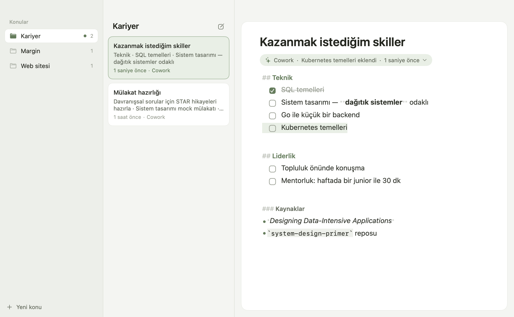
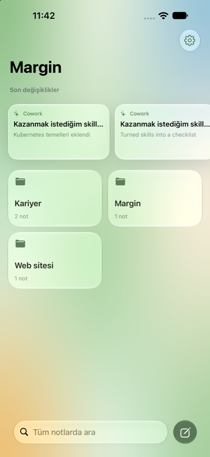
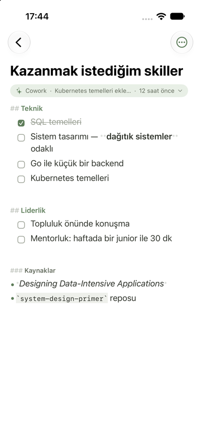
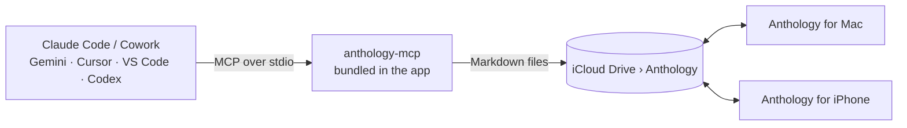

<p align="center">
  
</p>

<h1 align="center">Anthology</h1>
<p align="center"><b>Notes for Claude.</b> Say it in chat — it lands in a real notes app on your Mac and iPhone.</p>

<p align="center">
  <a href="#install">Install</a> ·
  <a href="#how-it-works">How it works</a> ·
  <a href="#shortcuts">Shortcuts</a> ·
  <a href="#privacy-and-security">Privacy & security</a> ·
  <a href="#build-from-source">Build from source</a>
</p>

<p align="center"></p>

You talk to Claude all day. Some of what you say is worth keeping — skills you want to learn, decisions,
lists, ideas. Today those end up buried in chat history or scattered in files Claude writes inside each
project. **Anthology** gives them a home:

- **"Save this to Anthology."** Claude Code, Claude Desktop/Cowork, Gemini CLI, Cursor, VS Code and Codex can
  write into Anthology through a local MCP server.
- **Living notes, not a pile of snippets.** Claude merges new information into the right note (adds the skill
  to your skill list) instead of appending duplicates. Every change is in the note's history, with Undo.
- **Organized by project.** Each project folder becomes a topic. Rename it freely — Claude keeps finding it.
- **Mac + iPhone.** Notes sync through your own iCloud Drive. No account, no server, nothing to sign up for.
- **Your files.** Every note is a plain Markdown file in iCloud Drive › Anthology. Open them in any editor.

<p align="center">
  
  &nbsp;
  
</p>

## Install

**Mac** (macOS 26+), one line:

```sh
curl -fsSL https://raw.githubusercontent.com/hazarustun-spec/anthology/main/install.sh | sh
```

or with Homebrew:

```sh
brew tap hazarustun-spec/anthology https://github.com/hazarustun-spec/anthology
brew install --cask anthology
```

or download `Anthology.dmg` from [Releases](../../releases) and drag it to Applications.

**iPhone**: coming soon. Notes already sync through iCloud Drive, so they'll be there when it lands.

**Connect your AI.** Anthology offers to connect Claude Code, Claude Desktop/Cowork, Cursor, VS Code, Gemini CLI
and Codex on first launch (**Settings › Connections** later). Claude Code users can use the plugin instead:

```
/plugin marketplace add hazarustun-spec/anthology
/plugin install anthology@anthology
```

The plugin adds the Anthology tools, the `//m` shortcuts, and two commands: `/anthology:save` (keep what
matters from this chat) and `/anthology:recall <topic>` (answer from your notes). It needs the Mac app installed.

Then say *"save this to Anthology"* in any conversation.

Running a session? There's a step-by-step [workshop guide (Turkish)](docs/workshop.md).

## How it works



- `anthology-mcp` is a small Swift MCP server shipped inside the app. The **Connect** buttons register it with
  each AI tool (backing up their config files and never touching anything else).
- Tools: `list_topics`, `get_note`, `search_notes`, `save_note`, `update_note`, `quick_capture`,
  `rename_topic`, `move_note`, `delete_note` (off by default).
- Topics are folders; notes are `.md` files with a small front matter (`id`, `title`, `revision`…);
  history lives next to them in `.history/`. Updates are compare-and-set on `revision`, so an AI never
  silently overwrites what you just typed.

## Shortcuts

| In chat | What happens |
|---|---|
| `//m add SQL to my skills` | **Smart save.** Claude files it into the right note, no confirmation. |
| `//m! call Ali tomorrow` | **Instant capture.** Saved word for word to the folder's *Quick notes*. In Claude Code it never reaches the model (zero tokens). |
| <kbd>⌥</kbd><kbd>⌘</kbd><kbd>M</kbd> anywhere on the Mac | Quick-note window. |
| <kbd>⌘</kbd><kbd>K</kbd> in Anthology | Search every note. |

Both chat prefixes and the hotkey are yours to change in **Settings › Shortcuts**.

## Privacy and security

- No backend. Notes stay in your iCloud Drive and on your devices.
- Signed with Developer ID and notarized by Apple. `install.sh` checks the signature, the developer team and
  Gatekeeper before installing anything.
- The Mac app is not sandboxed: it needs to edit your AI tools' config files (`~/.claude.json`,
  `~/.cursor/mcp.json`, …) when you press **Connect**. It backs each file up first and only touches its own entry.
- Optional Touch ID / Face ID lock.
- AI tools can't delete notes unless you allow it; every AI edit keeps the previous version (Undo);
  large removals are flagged; writes are rate-limited; note content is passed to models as data, not
  instructions. See the [security review](docs/security/2026-11-12-review.md).

## Build from source

Requirements: Xcode 27+, [XcodeGen](https://github.com/yonaskolb/XcodeGen).

```bash
cp App/Local.sample.xcconfig App/Local.xcconfig   # your team id + a bundle id you own
App/generate.sh                                   # creates App/Margin.xcodeproj
open App/Margin.xcodeproj
```

```bash
cd MarginKit && swift test          # core + MCP tool tests
scripts/mcp-smoke.sh                # end-to-end MCP check
```

Project layout: `MarginKit/` (store, MCP tools, `anthology-mcp`), `App/Shared` (design system, editor),
`App/Margin` (macOS), `App/MarginMobile` (iOS), `docs/` (design spec, plans, security review).

## FAQ

**Does it work with claude.ai in the browser?** Not yet — the web app can't reach a local MCP server.

**Is it affiliated with Anthropic?** No. Anthology is an independent open-source project that works with Claude.

## License

MIT — see [LICENSE](LICENSE).
